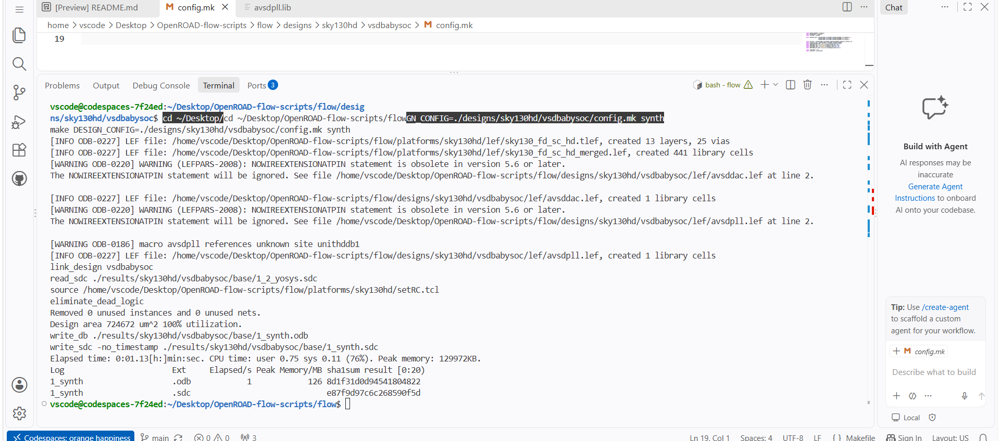
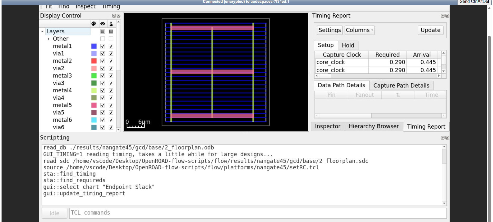
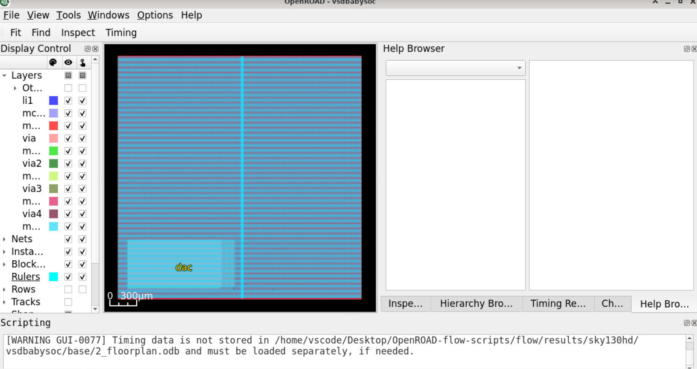
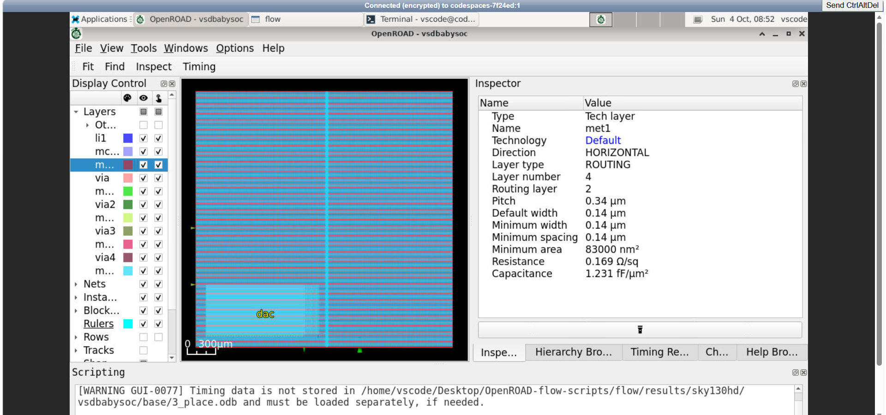
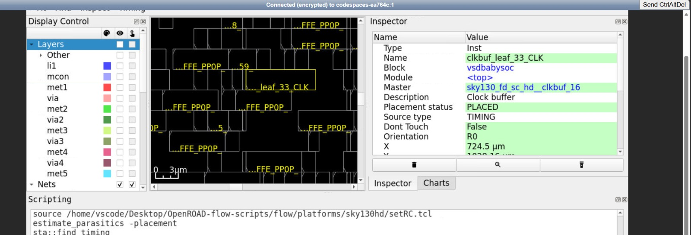
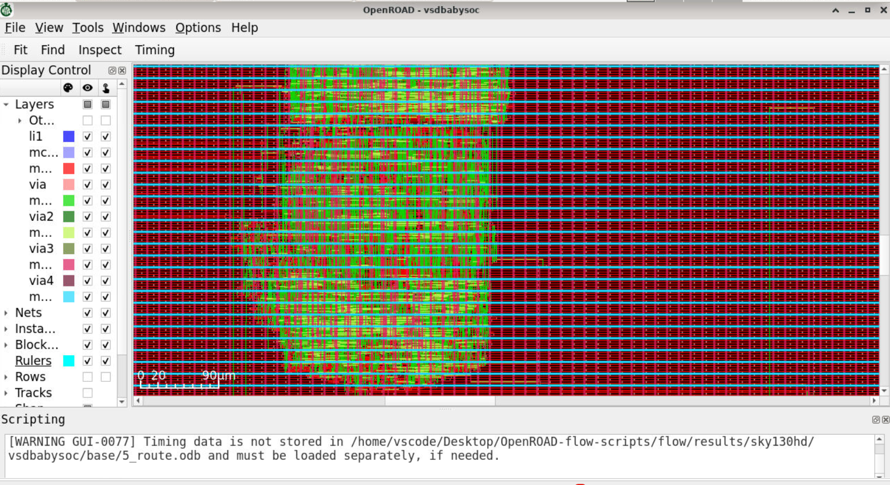
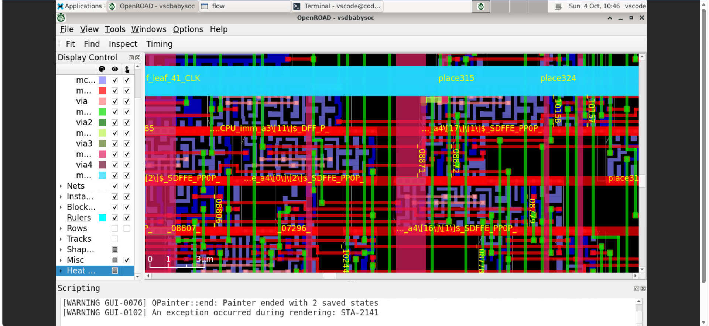

# VSDBabySoC Physical Design Lab — OpenROAD + OpenSTA

A practical record of taking the **VSDBabySoC** design through the main stages of digital ASIC physical implementation, from synthesis through routing and timing review.

This package is based on the screenshots and notes supplied with the lab work. It is organized as a standalone portfolio folder: this README gives the overall context, `reports/` contains stage-by-stage Markdown write-ups, and `images/` preserves the supplied visual evidence.

## Lab at a glance

| Item | Details |
|---|---|
| Design | VSDBabySoC |
| Technology | Sky130HD |
| Physical-design environment | OpenROAD flow |
| Timing analysis | OpenSTA |
| Evidence included | Synthesis output, floorplan views, placement views, CTS views, routing views, setup/hold timing screenshots and configuration screenshots |

## What this lab demonstrates

The core activity is the progression from a logical implementation to a physically organized design. The stages are related: each stage consumes the result of earlier work and prepares a more complete design for the next step.

1. **Synthesis** — prepare a gate-level representation of the RTL design.
2. **Floorplanning** — define the chip/core organization and account for block and I/O placement.
3. **Placement** — assign physical locations to standard cells and inspect their distribution.
4. **Clock-tree synthesis (CTS)** — build the clock-distribution network and inspect inserted clock buffers.
5. **Routing** — establish physical connectivity through metal layers and vias.
6. **Post-route timing review** — inspect setup and hold paths in OpenSTA.

## Workflow and observations

### 1. Synthesis and design setup

Synthesis is the starting point for physical implementation: RTL is mapped into library cells, producing a netlist and implementation database for downstream steps. The package includes a synthesis output screenshot and configuration screenshots that show the design setup used in the OpenROAD flow.



Configuration evidence: [`design_config_mk.png`](images/design_config_mk.png), [`flow_configuration_clock_floorplan.png`](images/flow_configuration_clock_floorplan.png), and [`pll_library_timing_configuration.png`](images/pll_library_timing_configuration.png).

### 2. Floorplan

The floorplan establishes the die/core organization, margins, and a starting arrangement for physical implementation. The included GUI screenshots show the floorplan and a saved database view.





### 3. Placement

Placement assigns locations to standard cells. The supplied views include a full placement view, alternate layer and terminal views, and a zoomed-out view. These are useful for observing the physical arrangement at different scales; they are not, by themselves, a numeric placement-quality report.



Additional evidence: [`03_placement_layer_view.png`](images/03_placement_layer_view.png), [`03_placement_terminal_view.png`](images/03_placement_terminal_view.png), and [`03_placement_zoomed_out.png`](images/03_placement_zoomed_out.png).

### 4. Clock-tree synthesis

CTS creates a network to distribute the clock to sequential elements. The lab screenshots contain full-design and close-up views of the resulting layout, as well as a selected clock-buffer instance. The images document inspection of the clock network, but no numerical clock-skew summary was supplied.




Additional evidence: [`04_cts_closeup.png`](images/04_cts_closeup.png), [`04_cts_gui_view.png`](images/04_cts_gui_view.png), [`04_cts_zoomed_view.png`](images/04_cts_zoomed_view.png), and [`cts_power_density_view.jpeg`](images/cts_power_density_view.jpeg).

### 5. Routing

Routing connects the placed instances using the available interconnect layers and vias. The supplied images show both a whole-design routing view and a more detailed view of the metal geometry.





A close-up congestion/metal view is also included as [`placement_congestion_detail.jpeg`](images/placement_congestion_detail.jpeg). The supplied package does not include an authoritative route summary file from which to report total wire length, via count, DRC count, or antenna violations; those numeric fields are therefore intentionally not inferred.

### 6. OpenSTA timing review

The supplied OpenSTA screenshots show timing-path reports for a maximum-delay (setup-oriented) path and a minimum-delay (hold-oriented) path.


The screenshots visibly show positive slack values for the displayed paths:
- Setup-oriented path: **7.35 slack (MET)**.
- Hold-oriented path: **0.28 slack (MET)**.

These are the slack values shown for the individual paths in the provided images, not a complete worst-slack summary for every path in the design. The accompanying reference notes report `WNS max = 0.00` and `TNS max = 0.00`; those values are preserved in the dedicated OpenSTA report as notes from the reference context, rather than being substituted for the path slack shown in the screenshots. To establish a single definitive timing summary, rerun/report the design using the exact final timing database, constraints, and parasitics.

## Reports index

| Report | Purpose |
|---|---|
| [`01_Synthesis_Report.md`](reports/01_Synthesis_Report.md) | Synthesis purpose, evidence, and output interpretation |
| [`02_Floorplan_Report.md`](reports/02_Floorplan_Report.md) | Floorplan organization and visual evidence |
| [`03_Placement_Report.md`](reports/03_Placement_Report.md) | Standard-cell placement observations |
| [`04_CTS_Report.md`](reports/04_CTS_Report.md) | Clock-tree synthesis and clock-buffer inspection |
| [`05_Routing_Report.md`](reports/05_Routing_Report.md) | Routed connectivity and design-view evidence |
| [`06_OpenSTA_Report.md`](reports/06_OpenSTA_Report.md) | Setup/hold timing commands and the values visible in screenshots |
| [`timing_summary.md`](reports/timing_summary.md) | Compact timing snapshot with evidence caveats |

## Folder layout

```text
PD_Lab_Work_Package/
├── README.md
├── images/
│   ├── 01_synthesis_output.png
│   ├── 02_floorplan_gui.png
│   ├── 03_placement_gui.png
│   ├── 04_cts_fullview.png
│   ├── 05_routing_full_view.png
│   ├── 06_opensta_setup_timing.png
│   ├── 07_opensta_hold_timing.png
│   └── ...additional supplied views...
└── reports/
    ├── 01_Synthesis_Report.md
    ├── 02_Floorplan_Report.md
    ├── 03_Placement_Report.md
    ├── 04_CTS_Report.md
    ├── 05_Routing_Report.md
    ├── 06_OpenSTA_Report.md
    └── timing_summary.md
```

## Tools and concepts encountered

- **OpenROAD** — physical-design implementation and GUI inspection.
- **OpenSTA** — static timing analysis of design paths.
- **Sky130HD** — standard-cell technology library referenced by the lab.
- **Floorplan, placement, CTS and routing** — sequential stages that transform a synthesized netlist into a connected physical layout.
- **Setup and hold timing** — complementary checks for data-path timing relative to the clock.

## Scope and data integrity

This is a report package assembled from the images and the supplied reference notes, not a regenerated OpenROAD run. It does not claim that the tools were re-executed here. Reported metrics are limited to what can be verified in the provided material; unavailable design statistics are marked as not supplied rather than guessed.

## Author / academic context

**B. Sangathram**  
B.Tech, III Year — Electronics and Communication Engineering  
Anurag University
