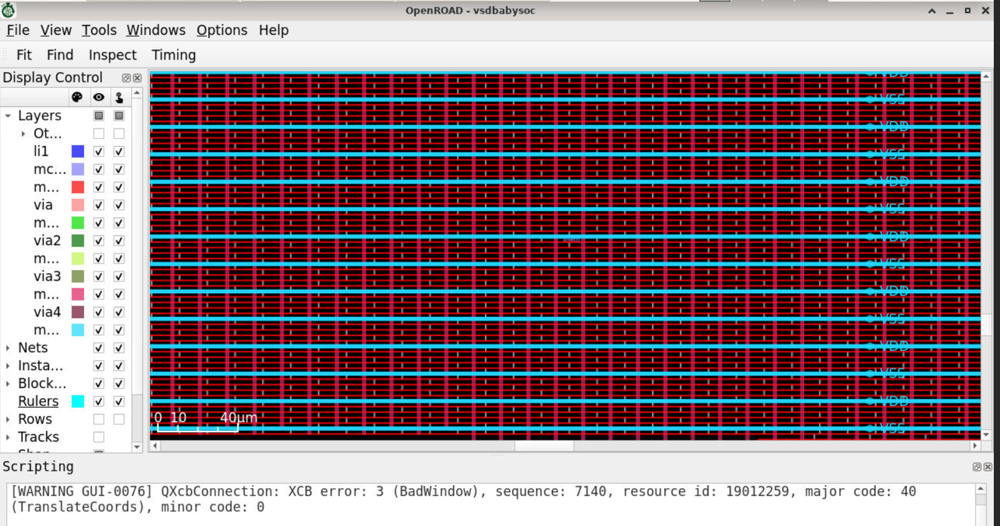
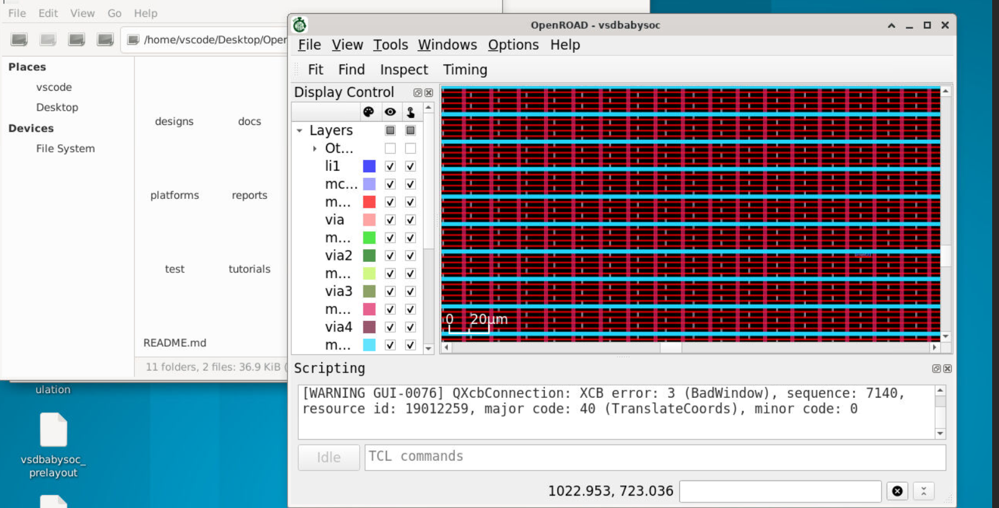

# Standard-Cell Placement Report — VSDBabySoC

## Objective
Placement assigns physical locations to the synthesized standard cells within the floorplan. Placement quality influences wire length, congestion, timing, and whether routing can complete cleanly.

## Lab evidence

The zoomed-out view is available at [`03_placement_zoomed_out.png`](../images/03_placement_zoomed_out.png).

## Observations
The supplied screenshots show the physical design at full-chip and closer scales. They document inspection of the placement view and associated layout layers. The images are visual evidence of the stage; they do not independently provide a complete numeric placement report.

## Engineering interpretation
Placement is not simply arranging cells visually. The implementation must respect legal rows, site alignment, fixed or pre-placed objects, placement blockages, and electrical/timing constraints. A useful next check is to review placement legality, estimated timing, utilization, and congestion reports from the same run.

## Recorded result
The supplied reference notes indicate that standard-cell placement was performed and inspected in the GUI.

## Data not supplied
No final cell count, utilization, total wire length, placement density, or detailed placement-warning summary accompanied the ZIP. Those values are deliberately left unreported.
