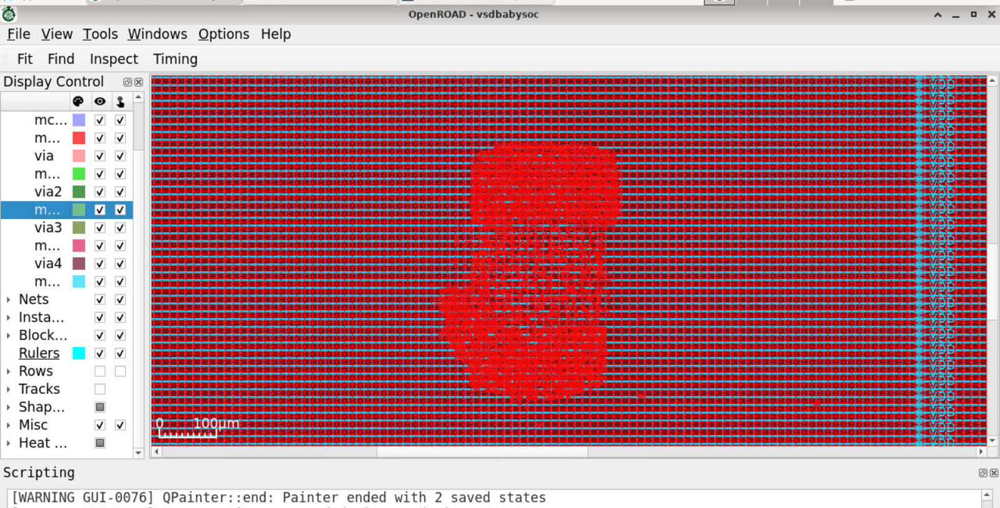
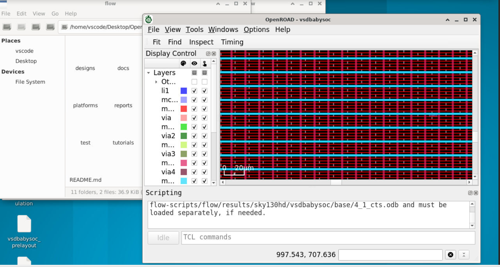

# Clock-Tree Synthesis Report — VSDBabySoC

## Objective
Clock-tree synthesis (CTS) builds a clock-distribution network between clock sources and sequential cells. It inserts and sizes clock buffers so the clock reaches the design while managing insertion delay and skew.

## Lab evidence

Other supplied views: [`04_cts_gui_view.png`](../images/04_cts_gui_view.png), [`04_cts_zoomed_view.png`](../images/04_cts_zoomed_view.png), [`cts_power_density_view.jpeg`](../images/cts_power_density_view.jpeg), and [`cts_clock_buffer_detail.jpeg`](../images/cts_clock_buffer_detail.jpeg).

## Observations
The screenshots show CTS-related layout views, including a selected clock-buffer instance in one view. This is consistent with inspection of the post-CTS physical design. The images do not expose a complete clock-tree summary or a definitive clock-skew report.

## Why CTS matters
Clock arrival-time differences affect setup and hold timing. CTS therefore changes the timing environment compared with pre-CTS placement, and timing should be re-evaluated after the clock network is created.

## Recorded result
The supplied context states that CTS was performed and inspected. No numeric insertion-delay, skew, buffer-count, or clock-tree power report was supplied, so these are not estimated.
