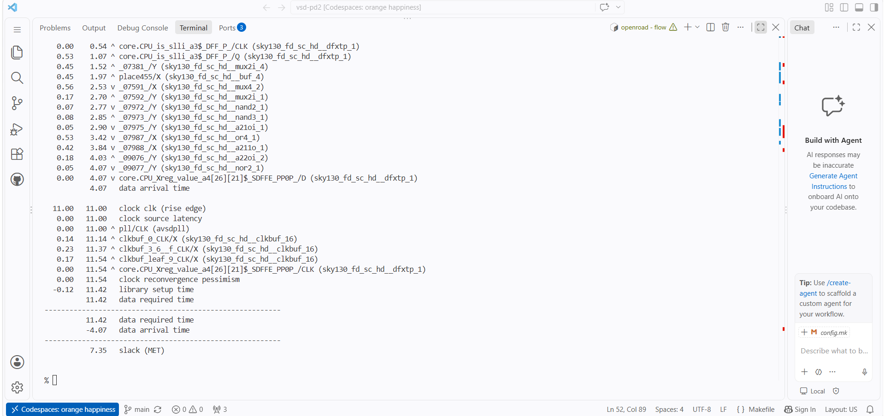
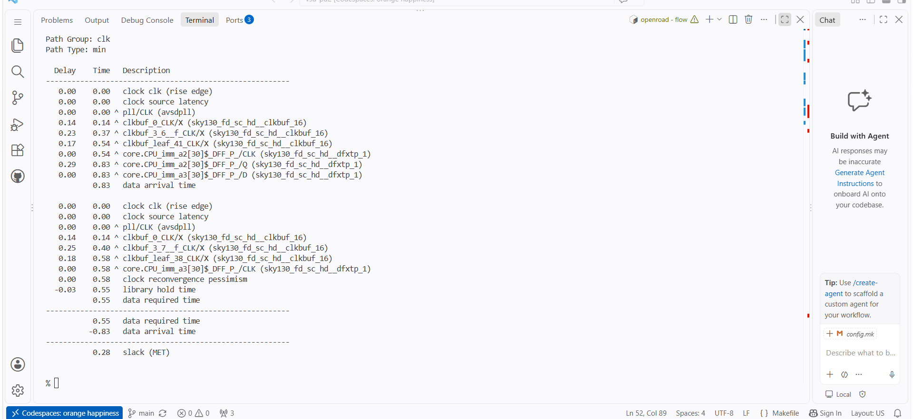

# Post-Route Timing Report — OpenSTA

## Objective
OpenSTA is used to inspect timing paths against the supplied timing constraints. Maximum-delay analysis is primarily associated with setup checks; minimum-delay analysis is used for hold checks.

## Commands recorded in the supplied context
```tcl
report_wns
report_tns
report_checks -path_delay max
report_checks -path_delay min
```

Run these after loading the matching design netlist/database, technology timing libraries, timing constraints, and the appropriate parasitics for the implementation stage being evaluated.

## Setup-oriented path evidence


The supplied setup screenshot displays a path slack of **7.35 (MET)** for the path shown. `MET` indicates that the displayed path meets the timing check under the screenshot's loaded constraints.

## Hold-oriented path evidence


The supplied hold screenshot displays a path slack of **0.28 (MET)** for the path shown. This indicates that the displayed minimum-delay path meets its hold check under the constraints present in that session.

## Interpreting the values carefully
The values `7.35` and `0.28` are the path slack values visible in the screenshots. They should not be labelled as global WNS/TNS because the images show individual path reports.

The reference context supplied with the lab notes separately records:
```text
WNS max = 0.00
TNS max = 0.00
```
These summary figures are preserved as reference notes in [`timing_summary.md`](timing_summary.md). The screenshots and reference summary may represent different report views or analysis states; without the exact final report log, constraints, units, and timing database, they cannot safely be reconciled into one definitive timing summary.

## Conclusion
The provided images show setup- and hold-oriented path reports whose displayed slacks are positive and marked `MET`. For sign-off-quality conclusions, capture the complete `report_wns`, `report_tns`, and worst max/min path reports from the same final routed design and constraint set.
