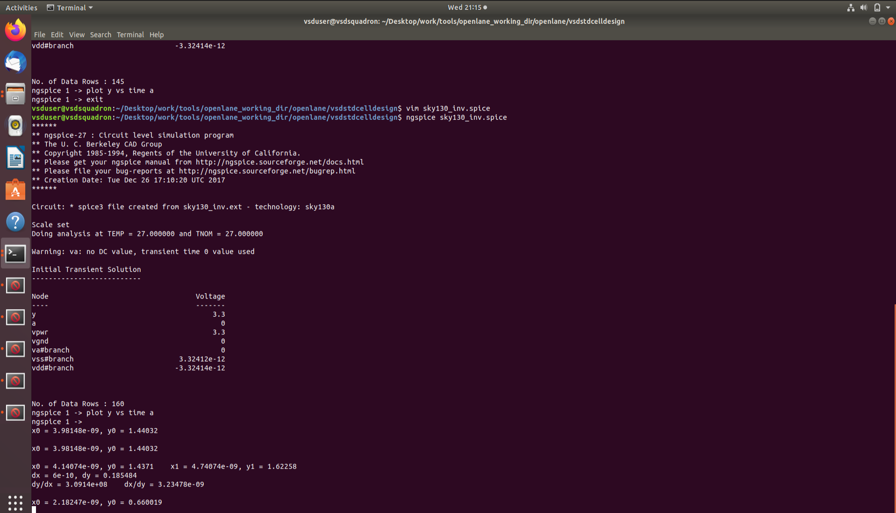
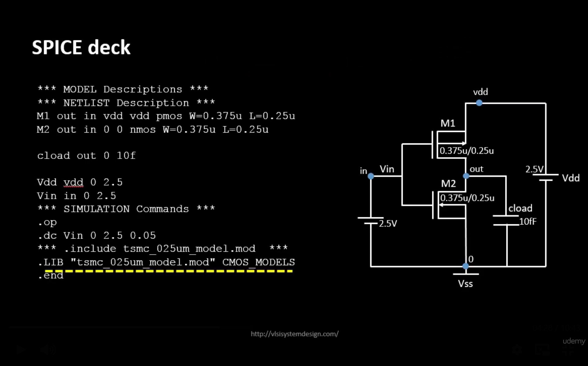
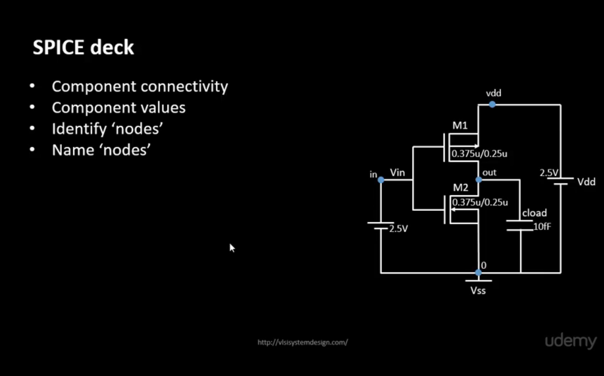
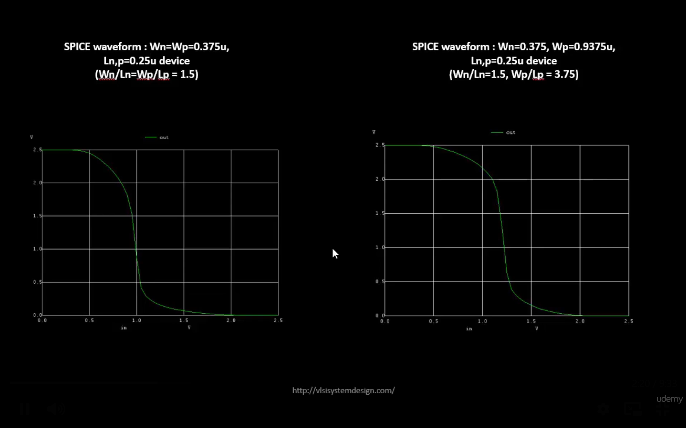
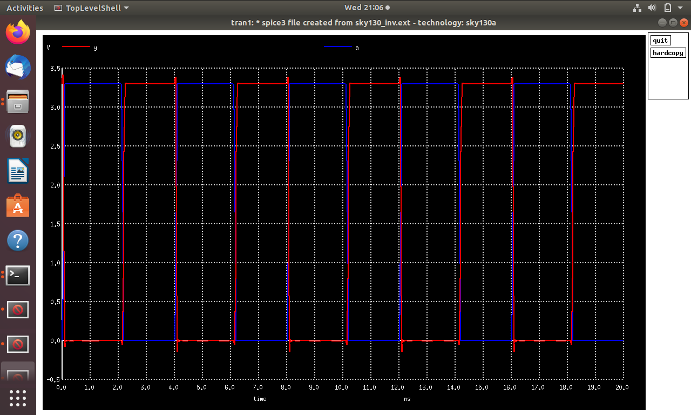
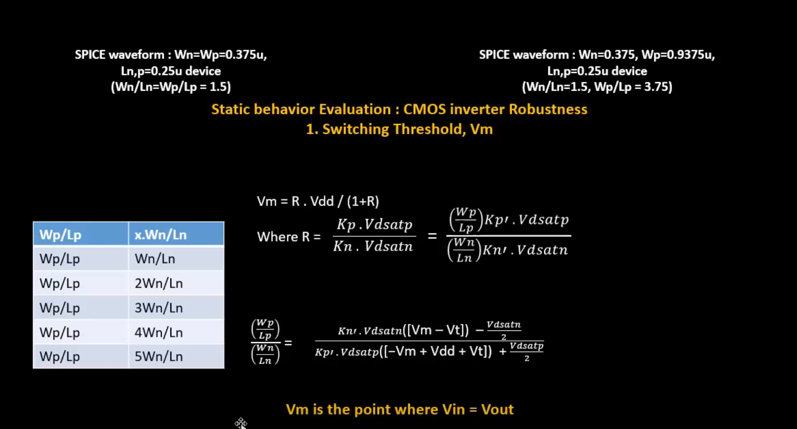
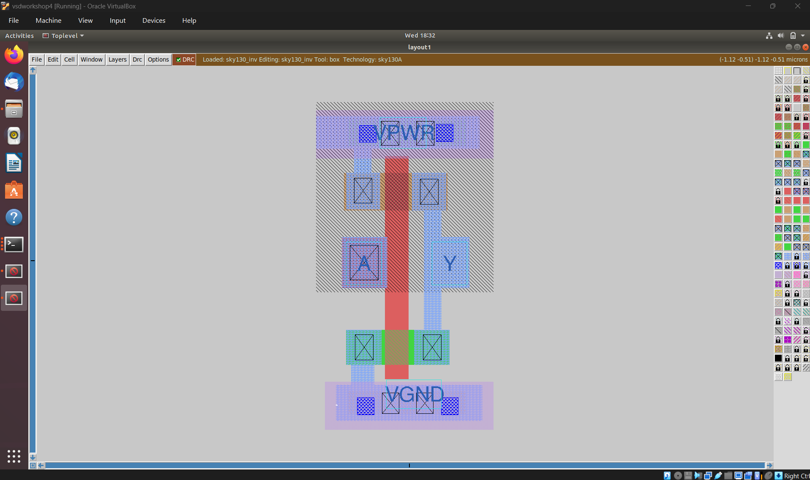

# Module 3 — Design Library Cell Using Magic Layout and ngspice Characterization

## Overview

Module 3 connects transistor-level simulation with physical standard-cell layout. The practical work begins with CMOS inverter simulation using ngspice and SPICE decks, studies switching threshold and static/dynamic behavior, and then moves into the physical CMOS fabrication sequence.

The module also introduces Sky130 basic layout layers, Magic layout work, extraction of a SPICE netlist, Sky130 technology files, DRC rules and practical exercises for identifying and fixing layout-rule problems.

## Learning Objectives

- Create and understand a SPICE deck for a CMOS inverter.
- Run CMOS inverter simulations using ngspice.
- Interpret static and transient inverter waveforms.
- Understand the switching threshold Vm.
- Relate CMOS circuit structures to physical fabrication steps.
- Identify active regions, wells, gate, LDD, source/drain, contacts and interconnect layers.
- Create a standard-cell layout using Magic.
- Extract a SPICE representation from layout.
- Use Sky130 technology/model files during characterization.
- Understand the purpose of DRC and geometric design rules.

## Topics Covered

### SKY130_D3_SK1 — Labs for CMOS Inverter ngspice Simulations

- IO placer revision
- SPICE deck creation for CMOS inverter
- SPICE simulation lab for CMOS inverter
- Switching Threshold Vm
- Static and dynamic simulation of CMOS inverter
- Lab steps to git clone `vsdstdcelldesign`

### SKY130_D3_SK2 — Inception of Layout – CMOS Fabrication Process

- Create active regions
- Formation of N-well and P-well
- Formation of gate terminal
- Lightly doped drain (LDD) formation
- Source-drain formation
- Local interconnect formation
- Higher-level metal formation
- Sky130 basic layers layout and LEF using inverter
- Create standard-cell layout and extract SPICE netlist

### SKY130_D3_SK3 — Sky130 Tech File Labs

- Create final SPICE deck using Sky130 technology
- Characterize inverter using Sky130 model files
- Introduction to Magic tool options and DRC rules
- Sky130 PDK and lab setup
- Load Sky130 technology rules in Magic
- Fix poly.9 error in the Sky130 tech file
- Implement poly-resistor spacing to diffusion and tap
- Describe DRC errors as geometrical constructs
- Identify missing or incorrect rules and fix them

## CMOS Inverter Simulation

The CMOS inverter contains complementary PMOS and NMOS devices. The SPICE-based laboratory work is used to observe its electrical response and to connect circuit-level behavior with later standard-cell characterization.

Important observations include:

- Input/output relationship of the inverter.
- Switching threshold Vm.
- Static behavior around logic states.
- Dynamic response during input transitions.
- Waveform behavior obtained from transient simulation.

## CMOS Fabrication Flow Introduced

```text
Substrate Selection
      ↓
Active Region Formation
      ↓
N-Well / P-Well Formation
      ↓
Gate Formation
      ↓
LDD Formation
      ↓
Source / Drain Formation
      ↓
Contacts and Local Interconnect
      ↓
Higher-Level Metal Formation
```

The workshop figures document these fabrication-related stages and provide a visual connection between process steps and the layers that appear in a standard-cell layout.

## Layout and Characterization Flow

```text
Circuit Design
      ↓
CMOS Inverter Layout
      ↓
Technology Rules / Sky130 PDK
      ↓
DRC Checking
      ↓
Layout Extraction
      ↓
SPICE Netlist
      ↓
ngspice Simulation / Characterization
```

## Figures and Practical Evidence

### 1. CMOS Inverter Simulation













### 2. CMOS Fabrication / Layout Sequence


### 3. Layout / Technology Work



## Magic, Sky130 and DRC

Magic is introduced as the layout environment used to inspect the physical geometry and apply technology-specific design rules. The Sky130 technology files provide the rule and layer information needed by the layout environment.

DRC is used to detect geometrical violations such as incorrect spacing or width relationships. The workshop exercises demonstrate how a reported DRC problem can be interpreted as a geometrical construct and then corrected.

## Key Takeaways

- ngspice provides circuit-level simulation and characterization of the CMOS inverter.
- The CMOS fabrication sequence explains how transistor structures and interconnect layers are physically formed.
- Magic provides a practical environment for standard-cell layout inspection and DRC work.
- Layout extraction connects the physical cell back to a SPICE representation.
- Sky130 technology files and model files are essential for technology-specific layout and characterization.
- DRC errors should be understood geometrically so that the physical layout can be corrected systematically.

## Tools / Technologies

- Magic
- ngspice
- Sky130 PDK / technology files
- SPICE
- Standard-cell layout concepts
