# Module 5 — Final Steps for RTL2GDS Using TritonRoute and OpenSTA

## Overview

Module 5 covers the routing and power-distribution stages that complete the main RTL-to-GDSII physical implementation flow. The module introduces maze routing using Lee's algorithm, design rule checking, power distribution network construction, global and detailed routing, and TritonRoute features.

The practical material also examines route guides, inter-guide connectivity, intra-layer and inter-layer routing, routing topology, connectivity handling and the files generated after routing.

## Learning Objectives

- Understand the basic idea behind maze routing and Lee's algorithm.
- Explain the purpose of Design Rule Checking (DRC).
- Understand the role of the power distribution network.
- Distinguish global routing from detailed routing.
- Understand how TritonRoute uses route guides.
- Understand inter-guide connectivity and intra-/inter-layer routing.
- Understand how routing topology and connectivity are handled.
- Identify important post-route results and files.

## Topics Covered

### SKY130_D5_SK1 — Routing and Design Rule Check (DRC)

- Introduction to Maze Routing — Lee's algorithm
- Lee's Algorithm conclusion
- Design Rule Check

### SKY130_D5_SK2 — Power Distribution Network and Routing

- Lab steps to build power distribution network
- Lab steps from power straps to standard-cell power
- Basics of global and detail routing and configuration of TritonRoute

### SKY130_D5_SK3 — TritonRoute Features

- TritonRoute feature 1 — Honors pre-processed route guides
- TritonRoute features 2 and 3 — Inter-guide connectivity and intra-/inter-layer routing
- TritonRoute method to handle connectivity
- Routing topology algorithm and final files list post-route

## Maze Routing — Lee's Algorithm

Lee's algorithm provides a systematic way to find a path between source and destination on a routing grid. The basic idea is to expand possible routing locations from the source until the destination is reached and then trace a valid path back through the explored grid.

```text
Source
  ↓
Grid Expansion / Wave Propagation
  ↓
Destination Reached
  ↓
Backtrace
  ↓
Routing Path
```

This algorithm provides a conceptual foundation for understanding how routing paths can be constructed while respecting available routing space.

## Design Rule Checking

DRC verifies whether the physical layout obeys technology-specific geometrical rules. Examples include wire width, spacing and via-related constraints. A DRC-clean layout satisfies the checked rules, while a violation indicates that a physical geometry needs correction.

## Power Distribution Network

The power distribution network distributes supply and ground through the chip. The workshop follows the relationship between power straps and the power connections of standard cells before moving into signal routing.

```text
Power Sources
      ↓
Power Distribution Network
      ↓
Power Straps
      ↓
Standard-Cell Power Connections
```

## Global and Detailed Routing

Global routing determines routing regions and approximate paths, while detailed routing creates the actual physical wire and via geometry while observing design rules. TritonRoute is introduced as the routing engine used in the workshop's implementation flow.

## TritonRoute Features

The module studies several routing features:

- Use of pre-processed route guides.
- Connectivity between different route guides.
- Intra-layer routing.
- Inter-layer routing.
- Connectivity handling when constructing final routes.
- Routing topology and post-route result files.

## Figures and Practical Evidence

### 1. Maze Routing and DRC

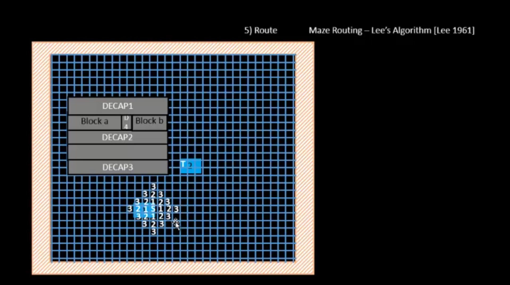


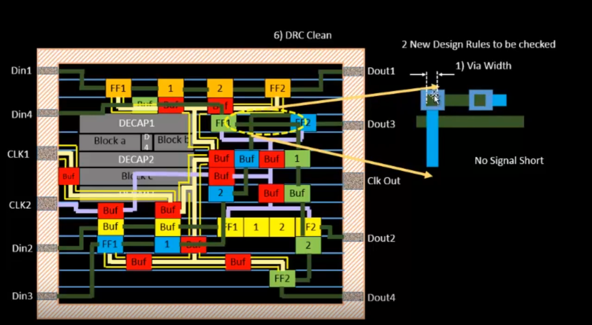

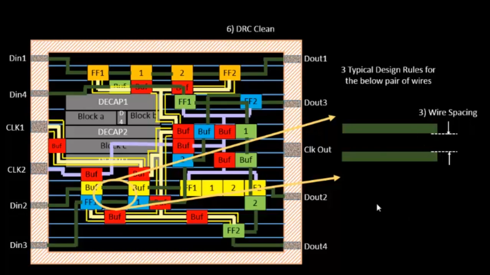

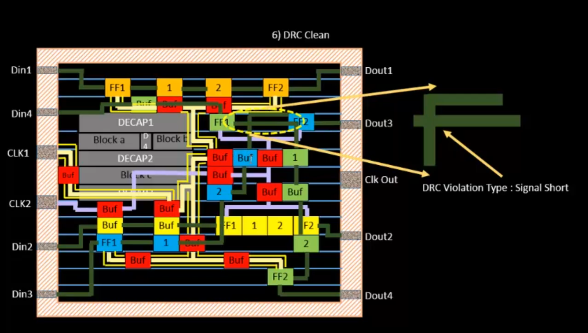

### 2. Power Distribution Network and Routing

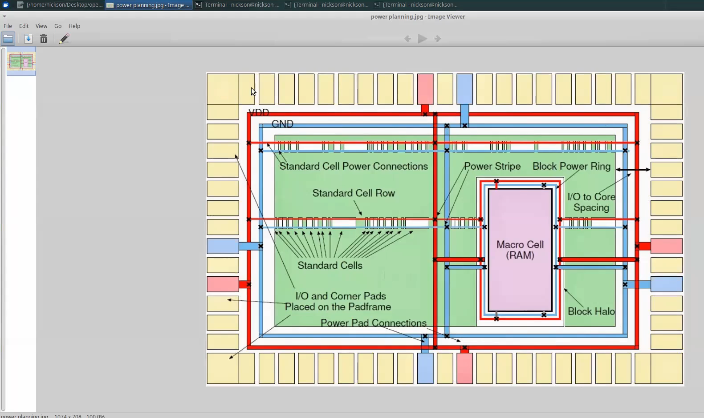

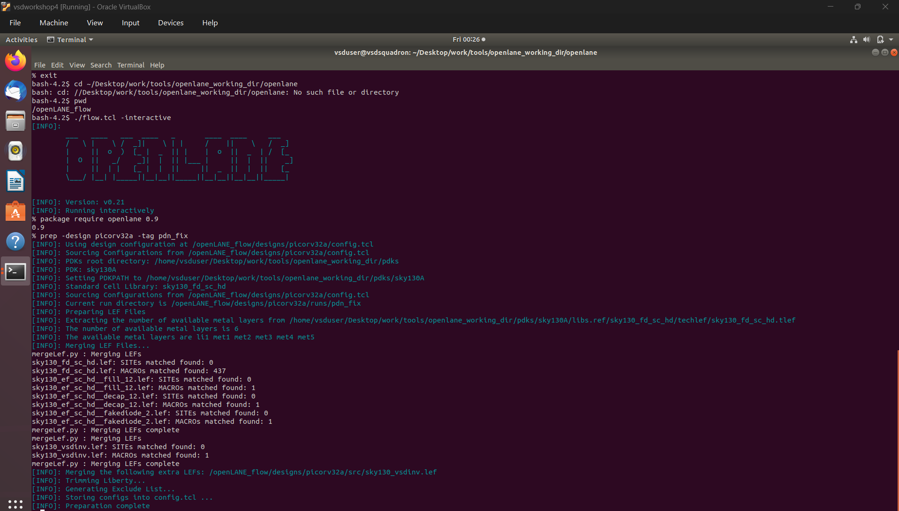

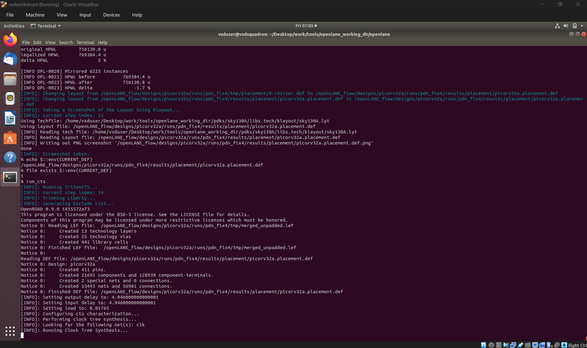

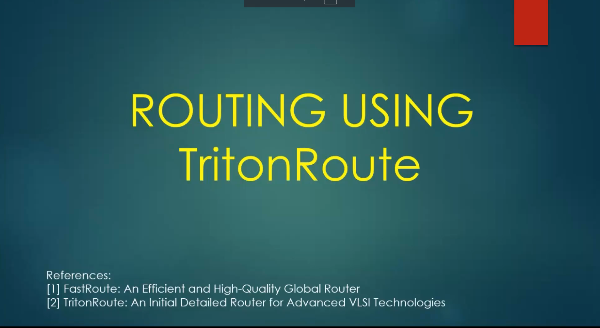

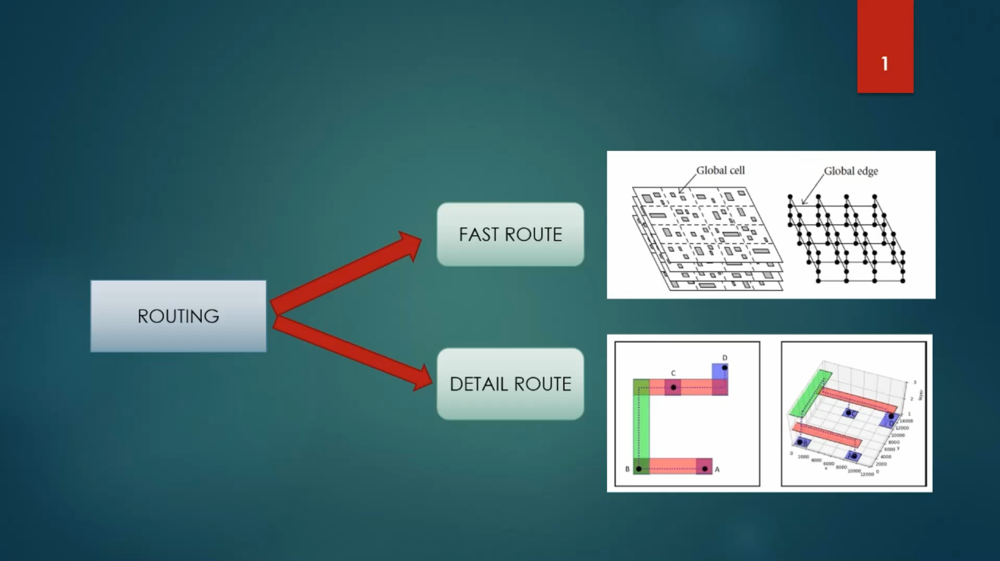

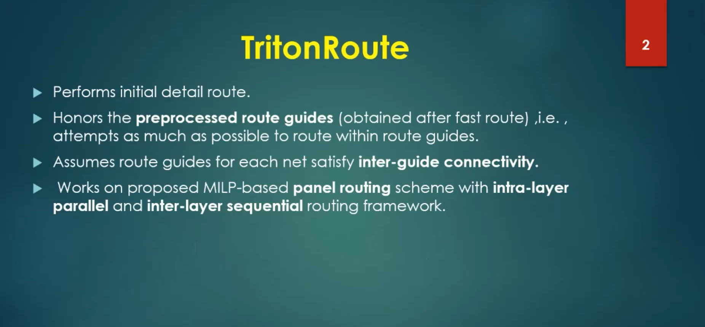

### 3. TritonRoute Route Guides and Connectivity

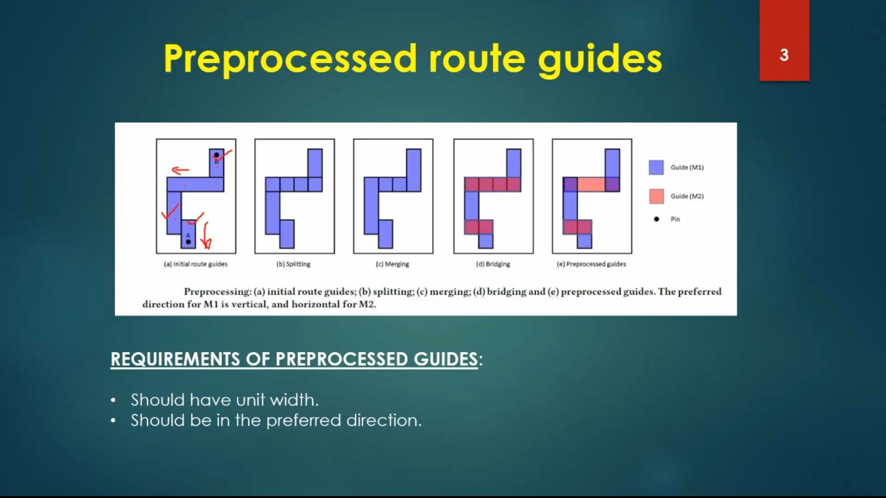

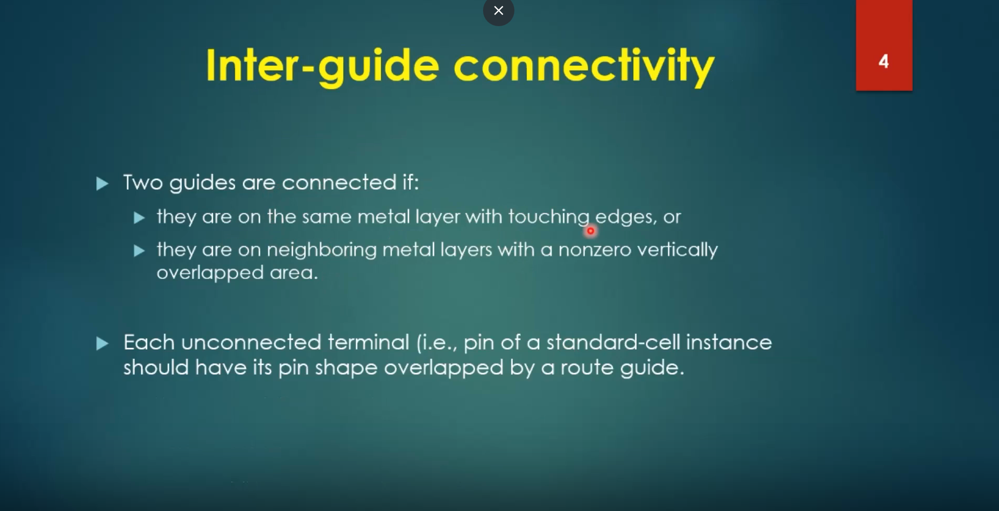

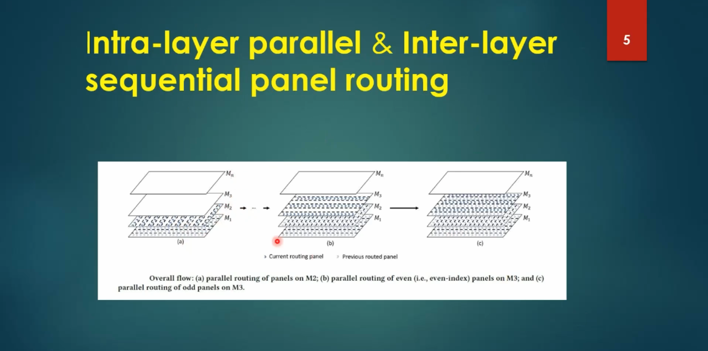

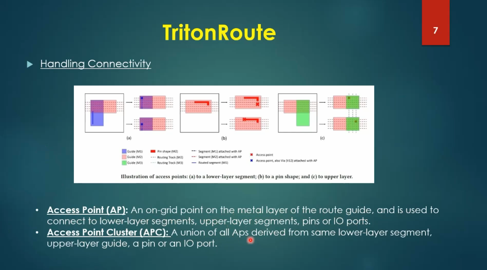

### 4. Routing Optimization and Final Results

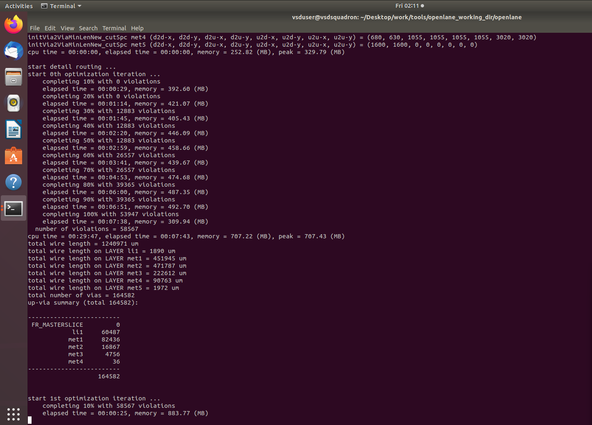

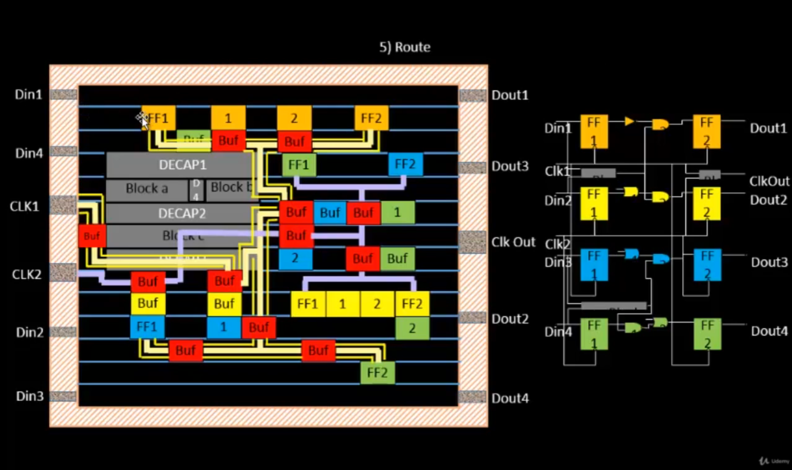

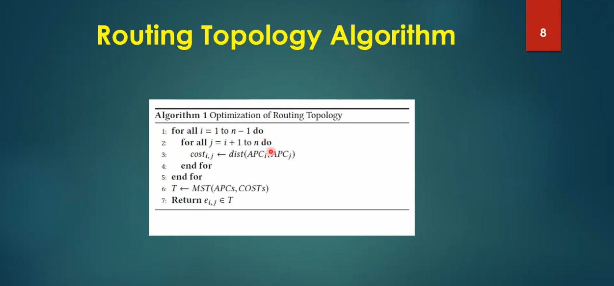


## Practical Flow

```text
Placed / CTS Design
        ↓
Power Distribution Network
        ↓
Global Routing
        ↓
Detailed Routing
        ↓
DRC / Physical Checks
        ↓
Post-Route Analysis
        ↓
Final Physical-Design Outputs
```

## Post-Route Understanding

After routing, the design contains physical signal routes, power structures and associated implementation data. The workshop introduces the final files and routing topology so that the learner can understand what is produced by the routing stage and how it contributes to the completed physical implementation.

## Key Takeaways

- Routing converts connectivity information into physical interconnect geometry.
- Lee's algorithm provides a useful conceptual model for maze routing.
- DRC checks physical geometry against technology-specific design rules.
- The PDN provides the power and ground distribution infrastructure.
- Global and detailed routing perform different levels of route planning and physical realization.
- TritonRoute uses route guides and routing strategies to construct final connections across routing layers.
- Post-route files provide evidence of the completed routing stage and support subsequent physical-design analysis.

## Tools / Technologies

- TritonRoute
- OpenLANE
- Sky130 PDK
- Magic / DRC concepts
- Global and detailed routing concepts
