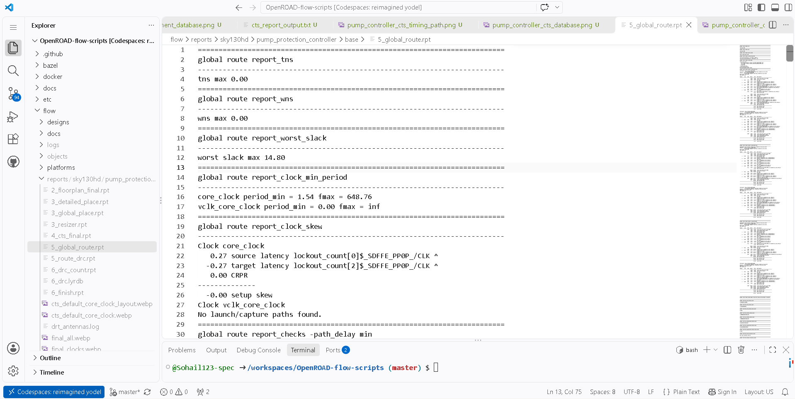
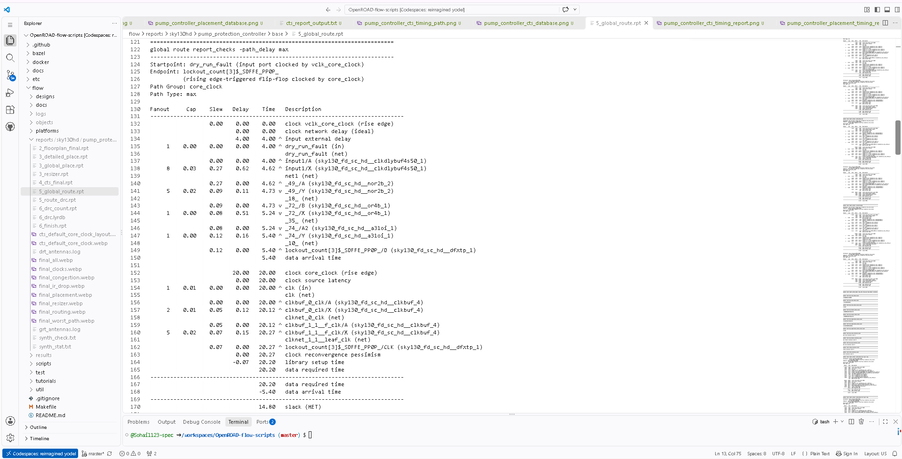
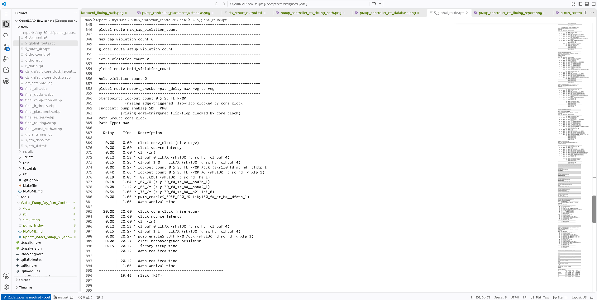

# P10 — Global Routing Evidence

## Purpose
P10 captures global-routing results, including timing-path and routing-violation review.

## Evidence inventory
- [`pump_controller_global_route_report.png`](./pump_controller_global_route_report.png) — global-route report summary.
- [`pump_controller_global_route_timing_path.png`](./pump_controller_global_route_timing_path.png) — representative global-route timing path.
- [`pump_controller_global_route_violations.png`](./pump_controller_global_route_violations.png) — global-route violation view.

## Evidence gallery

The images below render directly in this README on GitHub. The original image files remain in this folder for separate viewing or download.

### pump controller global route report

### pump controller global route timing path

### pump controller global route violations

## Recorded result
The project progress notes report TNS/WNS of 0 and worst slack of **+14.80 ns** for the archived global-route result.

## What to review
- Global-routing completion and the reported timing summary.
- The selected path and the constraints applied to it.
- Routing-violation output; global-route violations are distinct from final detailed-route DRC results.
- Any warnings that remain in the flow logs.

## Review checklist
- [ ] Confirm the screenshots identify the global-route stage.
- [ ] Cross-check the timing result against the report output in the flow tree.
- [ ] Do not describe global routing as final detailed routing or signoff.

**Status note:** P10 is recorded as passed in the project progress log for the included global-route evidence.

## Related evidence
- [P9 — CTS](../P9/README.md)
- [P11 — Final timing, DRC, and routed layout](../P11/README.md)
