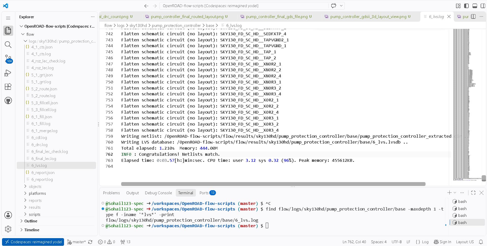

# P13 — Layout Versus Schematic (LVS) Evidence

## Purpose
P13 records the result of the LVS comparison performed by the archived physical-design flow.

## Evidence in this folder
- [`pump_controller_lvs_netlists_match.png`](./pump_controller_lvs_netlists_match.png) — screenshot of the LVS log/result.
- Log source: `flow/logs/sky130hd/pump_protection_controller/base/6_lvs.log`.

## Evidence gallery

The images below render directly in this README on GitHub. The original image files remain in this folder for separate viewing or download.

### pump controller lvs netlists match

## Recorded result
The project notes state that the included LVS log contains the message **“Congratulations! Netlists match.”**

## Interpretation and limits
This result applies to the netlists and comparison represented by that specific flow run. It does not independently prove correct behavior in silicon, certify the design for fabrication, or constitute foundry signoff.

## Review checklist
- [ ] Inspect the screenshot and, when available, the full `6_lvs.log`.
- [ ] Confirm the comparison refers to the expected design and final layout.
- [ ] Present the result as a match for the included LVS comparison only.
- [ ] Pair this evidence with the final GDS and DRC/timing review.

**Status note:** P13 is recorded as passed for the included netlist comparison.

## Related evidence
- [P11 — Final timing/DRC/layout review](../P11/README.md)
- [P12 — GDSII generation](../P12/README.md)
- [P14 — Artifact integrity inventory](../P14/README.md)
