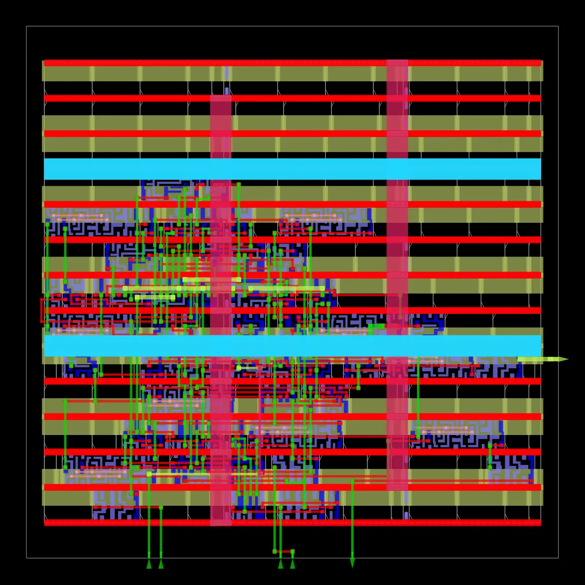

# P15 — Final Report and Demonstration Handoff

## Purpose
P15 is the presentation/handoff checkpoint for explaining the controller, demonstrating its verification evidence, and summarizing the archived physical-design result.

## Contents
- [`../../FINAL_REPORT.md`](../../FINAL_REPORT.md) — project objective, RTL/verification summary, synthesis results, physical-design outputs, limitations, and demo checklist.
- [`pump_controller_final_layout_overview.webp`](./pump_controller_final_layout_overview.webp) — generated final-layout overview image from the archived run, when present.

## Suggested demonstration sequence
1. Explain the dry-run protection problem and the external `dry_run_fault` input.
2. Show `rtl/pump_protection_controller.v`, including `pump_enable` and `fault_status`.
3. Show the four testbench files and P4 waveform screenshots/VCD files.
4. Review safety and corner-case tests in P5.
5. Show synthesis checks/statistics and the generated netlist in P6.
6. Walk through floorplan, placement, CTS, global-route, and final timing/layout evidence in P7–P11.
7. Show the GDS Inspector 2D/3D views in P12.
8. Show the LVS comparison result in P13 and SHA-256 manifest in P14.
9. State limitations clearly: the RTL relies on an external digital detector and the archived checks do not establish foundry signoff.

## Presenter checklist
- [ ] Use the same project snapshot as the screenshots and reports.
- [ ] Explain what each checkpoint proves and what it does not prove.
- [ ] Avoid describing archived results as freshly rerun during documentation work.
- [ ] Keep a copy of the source and final report available during the demonstration.

## Completion boundary
P15 organizes the final report and demonstration material. It should be marked complete only when the required presentation/demo handoff is actually prepared and any course-specific acceptance criteria are met.

## Evidence gallery

The images below render directly in this README on GitHub. The original image files remain in this folder for separate viewing or download.

### pump controller final layout overview

