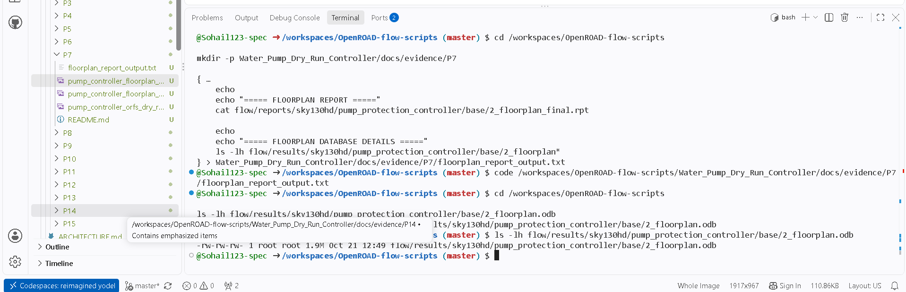
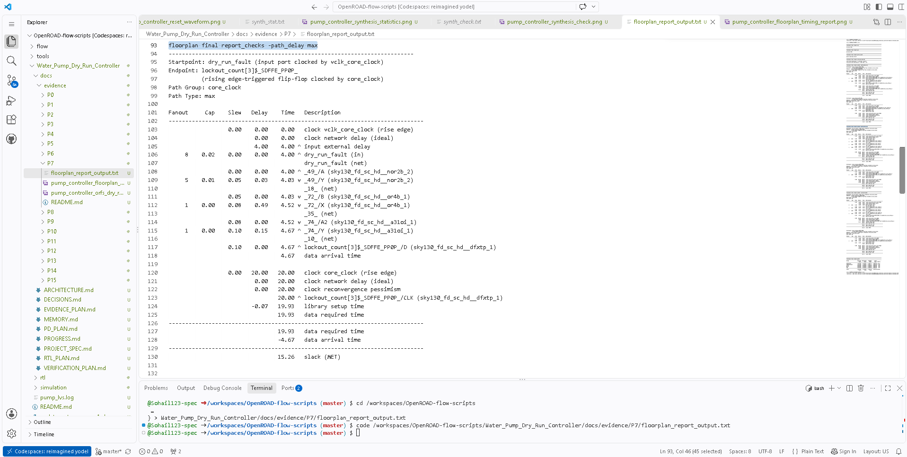
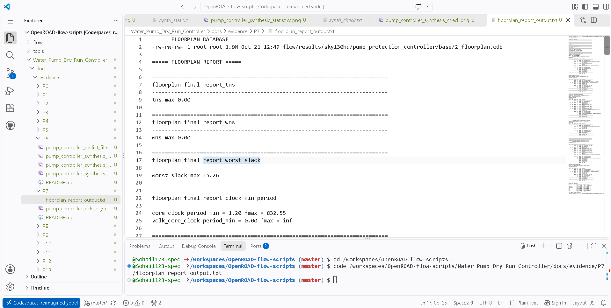
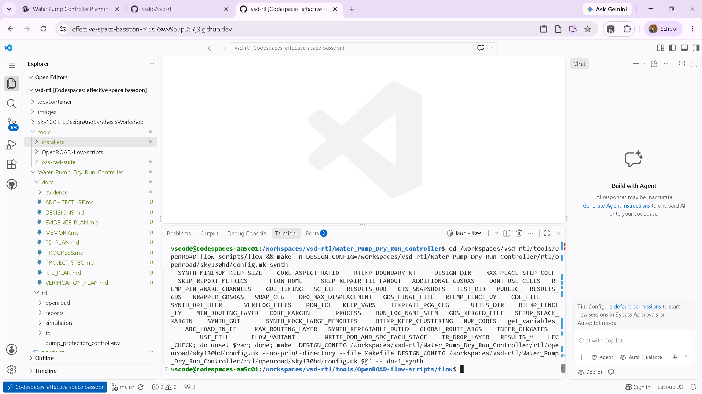

# P7 — Flow Setup and Floorplanning Evidence

## Purpose
P7 records the flow configuration/dry-run and the floorplanning stage for the Sky130HD physical-design flow.

## Evidence inventory
- [`pump_controller_orfs_dry_run.png`](./pump_controller_orfs_dry_run.png) — OpenROAD-flow-scripts dry-run/configuration evidence.
- [`pump_controller_floorplan_timing_report.png`](./pump_controller_floorplan_timing_report.png) — floorplan-stage timing summary.
- [`pump_controller_floorplan_timing_path.png`](./pump_controller_floorplan_timing_path.png) — representative timing-path view.
- [`pump_controller_floorplan_database.png`](./pump_controller_floorplan_database.png) — floorplan database/layout view.
- [`floorplan_report_output.txt`](./floorplan_report_output.txt) — captured floorplan report output.

## Evidence gallery

The images below render directly in this README on GitHub. The original image files remain in this folder for separate viewing or download.

### pump controller floorplan database

### pump controller floorplan timing path

### pump controller floorplan timing report

### pump controller orfs dry run

## Recorded result
The progress record reports floorplan TNS/WNS of 0 and worst slack of **+15.26 ns** for the archived configuration.

## What to review
- Flow setup and selected platform/configuration.
- Floorplan shape, utilization, and placement region.
- Timing path and constraints represented by the report.
- Warnings in the flow output; a dry-run or successful floorplan stage alone is not signoff.

## Review checklist
- [ ] Verify the screenshots correspond to the pump-controller design and floorplan stage.
- [ ] Read the text report rather than relying only on the screenshot.
- [ ] Note the SDC/clock assumptions and any warnings.
- [ ] Compare this stage with placement and CTS results in P8/P9.

**Status note:** P7 is recorded as passed in the project progress log for the included stage outputs.

## Related evidence
- [P6 — Synthesis](../P6/README.md)
- [P8 — Placement](../P8/README.md)
