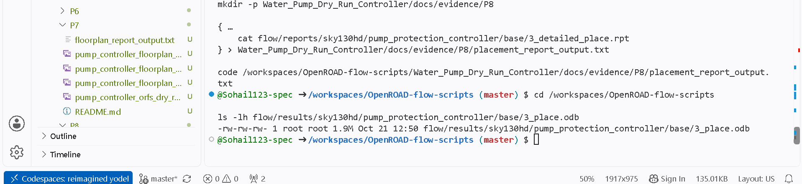
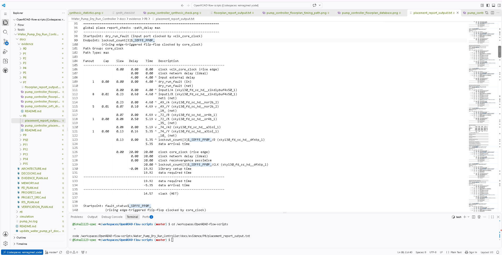
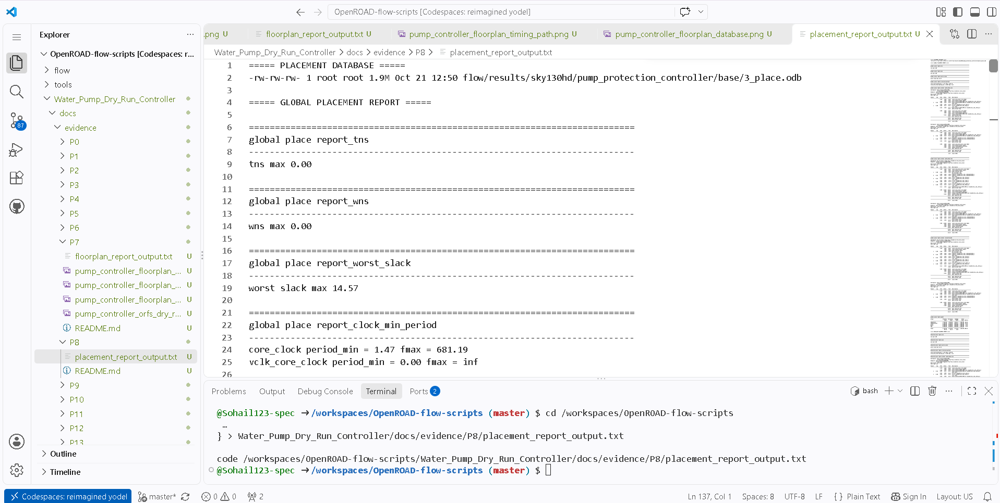

# P8 — Placement Evidence

## Purpose
P8 documents standard-cell placement and the timing/path evidence captured after the placement stage.

## Evidence inventory
- [`pump_controller_placement_timing_report.png`](./pump_controller_placement_timing_report.png) — placement-stage timing summary.
- [`pump_controller_placement_timing_path.png`](./pump_controller_placement_timing_path.png) — representative timing path.
- [`pump_controller_placement_database.png`](./pump_controller_placement_database.png) — placement database/layout view.
- [`placement_report_output.txt`](./placement_report_output.txt) — captured placement report output.

## Evidence gallery

The images below render directly in this README on GitHub. The original image files remain in this folder for separate viewing or download.

### pump controller placement database

### pump controller placement timing path

### pump controller placement timing report

## Recorded result
The project progress notes report TNS/WNS of 0 and worst slack of **+14.57 ns** for the archived placement result.

## What to review
- Standard-cell placement and resulting layout distribution.
- Timing summary and the path selected for inspection.
- Report constraints and warnings, including whether the clock/path is meaningful for the stated analysis.
- Differences from the floorplan stage.

## Review checklist
- [ ] Confirm the evidence is from the placement stage.
- [ ] Use the text report to validate values shown in screenshots.
- [ ] Record any warnings rather than assuming they were resolved.
- [ ] Continue to CTS evidence in P9.

**Status note:** P8 is recorded as passed in the project progress log for the included placement outputs.

## Related evidence
- [P7 — Floorplanning](../P7/README.md)
- [P9 — Clock-tree synthesis](../P9/README.md)
